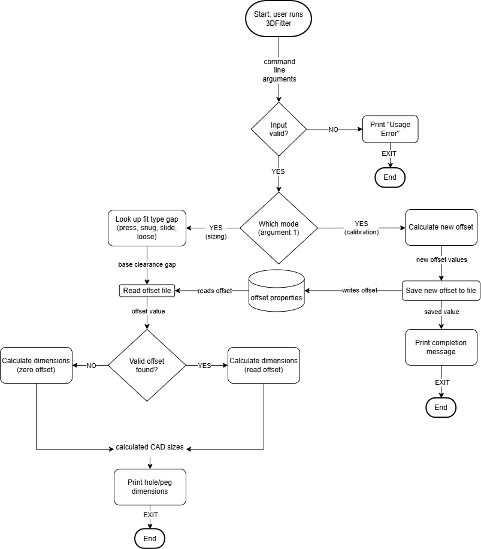

# 3DFitter

A Java command-line tool that turns a size and fit type into calibrated hole and peg dimensions for 3D-printed parts.

## The Problem
When I design 3D printed parts for projects I'm working on, I have to guess a clearance, print, test the fit and adjust if it isn't perfect. The problem is these guesses cause poor initial fits, leading to wasted time and material. This matters to me because a bad fit causes a joint that wobbles, a pin that jams, or a part that won’t assemble.

## MVP Scope
 - Take the size and fit type the user types in (eg java ThreeDFitter 10 slide)
 - Four fit types (press, snug, slide, loose), each with a set gap in mm
 - Work out and print the hole and peg sizes to use in CAD
 - Calibration: type in the planned size and the measured size of a test print, and the tool works out and saves that printer's offset to a file, then uses it in every result
 - Show a clear error message for bad input (letters, negative sizes, unknown fit types) or a missing offset file

## How It Works

## Tech Stack
 - Language: Java (learning in CS180, built in support for decimal math, file I/O).

 - Libraries/Built-in Packages: Java Standard Library using String[] args for CLI input parsing, Double.parseDouble() for parsing numbers, java.util.Properties for structured key-value file handling plus JUnit 5 (external) for testing.

 - Data Storage: A plain .properties file (printer_offset.properties) to store offset data (eg offset=0.18).

 - Data Sources: Internal hardcoded target clearance values (for press, snug, slide, and loose fits) and manual caliper measurements recorded from physical test prints.

 - Development Tools: VS Code, JDK, Git+GitHub, draw.io

 - Testing: JUnit, by running automated test assertions comparing calculated outputs against hand-calculated values. (new to me, will learn it)

 - Hardware: 3D printer, digital caliper

## Future Plans
- [ ] Save offsets for more than one printer or filament (eg --profile bambu-petg) week 12 build.
- [ ] Different offsets for holes and for pegs
- [ ] Use the average of several test prints for a better offset
- [ ] User-made fit types (eg "my-snap-fit = 0.15 mm")
- [ ] Slots and square shapes, not just round holes and pegs

## Author
Shubhan Anchan, github.com/shubhananchan
